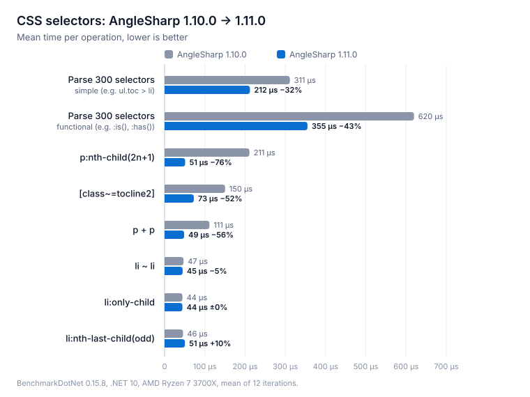
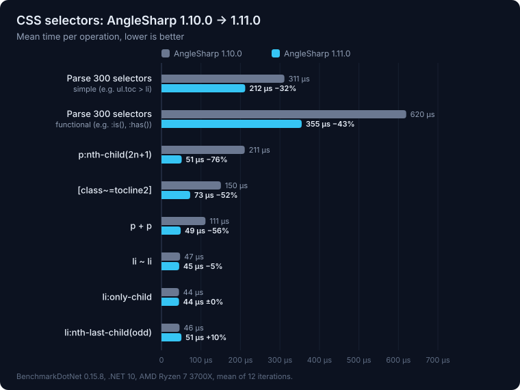
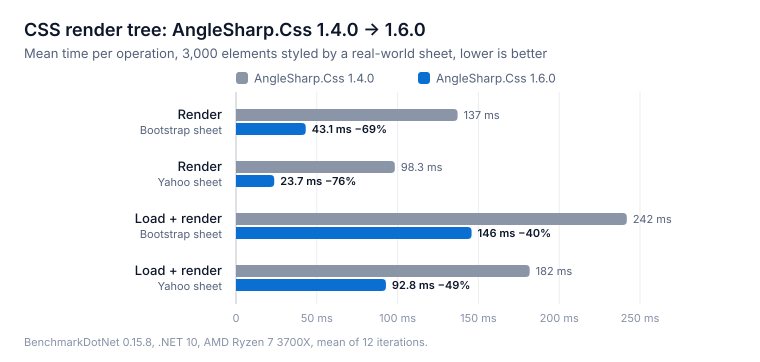
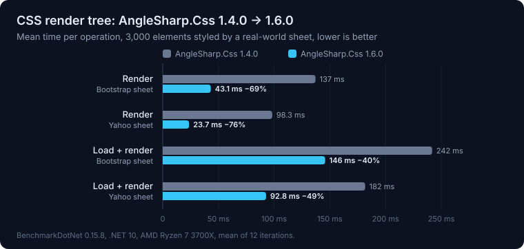
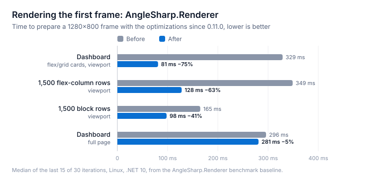
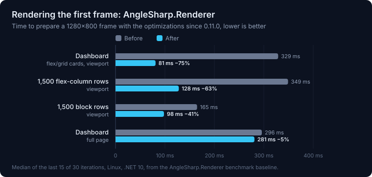

Release day again, and this one is special:

**AngleSharp 1.11.0 is here!** 🚀

AngleSharp is a web utility library for .NET, written entirely in C#. It is the de-facto standard for parsing HTML5 on the .NET platform. Its architecture also makes it more than an HTML parser: it is the core of a headless browser. Associated libraries such as AngleSharp.Css or AngleSharp.Js add more of the web platform, such as style computation or script evaluation.

Curious how it all started? The article [My OSS Projects: AngleSharp](https://dev.to/florianrappl/my-oss-projects-anglesharp-3b8j) on dev.to tells the story. It begins in 2013 with a printed copy of the HTML5 specification on a flight to the Microsoft MVP Summit. It then covers the modular architecture that arrived with 0.10, the road to 1.0, and how the project grew to more than 310 million downloads. Releases like this one are the next chapters of that story.

The v1.11 release is a major milestone for the whole project. For the first time, **every library that AngleSharp.Browser depends on has been released with AngleSharp 1.11 as its minimum version**, and every one of them is **AoT friendly**.

## The Whole Ecosystem, in Lockstep

AngleSharp 1.11.0 ships together with a new release of every companion library:

| Package | Version |
|---|---:|
| AngleSharp | **1.11.0** |
| AngleSharp.Css | **1.6.0** |
| AngleSharp.Js | **1.3.0** |
| AngleSharp.Io | **1.4.0** |
| AngleSharp.Wasm | **1.2.0** |
| AngleSharp.Xml | **1.4.0** |
| AngleSharp.Renderer | **0.13.0** |
| AngleSharp.Browser | **0.3.0** |

All of them require **AngleSharp 1.11.0**, so they now share one common foundation. If you use several of these packages, update them together.

Two versions on that list still start with a zero, and that will change soon:

- **AngleSharp.Renderer 1.0.0** is coming, and it will happen **this year**.
- **AngleSharp.Browser 1.0.0** is expected shortly after the renderer reaches 1.0.0.

## Native AoT, Across the Board

The biggest theme of this release cycle is **ahead-of-time (AoT) compilation and trimming**.

Until now, scripting engines discovered the DOM by reflection. They scanned the AngleSharp assemblies for WebIDL attributes such as `[DomName]` and built the JavaScript surface from what they found. That works well on a regular .NET runtime, but reflection doesn't fit the trimmer or native AoT. The trimmer can't see which types reflection will touch at runtime, so it either keeps too much or removes something that is needed later.

With 1.11 this changes. The DOM can now be **declared in code**, as strongly typed delegates, without any reflection at runtime. What gets registered is exactly what the trimmer keeps.

### `DomRegistry` and `DomRegistration`

AngleSharp 1.11.0 introduces a small contract in the `AngleSharp.Scripting` namespace:

- **`DomRegistration`** is a delegate that takes a `DomRegistry`. Each AngleSharp library ships one for its own DOM, so it always matches the version you use.
- **`DomRegistry`** is implemented by the scripting engine. It declares types (`Type<T>`), mixins (`Mixin<T>`), constants, WebIDL enumerations (`Literals<TEnum>`), namespaces, named constructors and window instances. Each type then gets its prototype chain, members, constructors, static members, indexers and event handlers.
- **`DomArguments`** gives a registered member the arguments the script passed, converted on request. **`DomCallback`** represents a function the script passed in.
- **`DomRegistrations.Combine`** joins the registrations of several libraries. They run in order, so a later library can add members to a type an earlier one declared.

Here is a hand-written registration:

```cs
DomRegistration registration = registry =>
{
    registry.Type<INode>("Node")
        .Property("textContent", node => node.TextContent, (node, value) => node.TextContent = value);

    registry.Type<IElement>("Element")
        .Inherits<INode>()
        .Method("getAttribute", (element, args) => element.GetAttribute(args.Get<String>(0)), length: 1);
};
```

Every member is a strongly typed delegate, so the engine never needs reflection to call it.

### A New Way of Registering APIs in AngleSharp.Js

For [AngleSharp.Js 1.3.0](https://github.com/AngleSharp/AngleSharp.Js/releases/tag/v1.3.0) this meant a completely new way of registering APIs. The new `WithJs(DomRegistration)` overload takes a registration and exposes **exactly** what it declares to scripts. No assembly is scanned and no attribute is read:

```cs
var config = Configuration.Default
    .WithCss()
    .WithIo()
    .WithJs(DomRegistrations.Combine(CssDom.Register, IoDom.Register))
    .WithEventLoop();
```

The DOM of AngleSharp itself (`CoreDom`) and of AngleSharp.Js are always registered first. You only name the other libraries you use. Each of them ships its own registration:

- `CssDom.Register` in AngleSharp.Css
- `IoDom.Register` in AngleSharp.Io
- `WasmDom.Register` in AngleSharp.Wasm
- `XmlDom.Register` in AngleSharp.Xml
- `RendererDom.Register` in AngleSharp.Renderer

AngleSharp.Browser already works this way and combines all of these with its own `BrowserDom.Register`.

**The old way still works.** If you call `WithJs()` without a registration, AngleSharp.Js falls back to reflection over the DOM attributes, exactly as before. Existing applications keep running unchanged, and you can switch whenever you want to trim or AoT-compile.

### The DOM Registration Generator

Nobody should have to write these registrations by hand, and nobody has to.

The attribute-based model is still the source of truth. It now feeds a **Roslyn-based source generator that ships inside the AngleSharp 1.11.0 package**. Every project that references AngleSharp gets a generator that matches the contract it compiles against. There is nothing extra to install.

To use it, add one assembly attribute that names the static class to generate:

```cs
[assembly: GenerateDomRegistration("MyApp.AppDom")]
```

or, in the project file:

```xml
<ItemGroup>
  <AssemblyAttribute Include="AngleSharp.Attributes.GenerateDomRegistrationAttribute">
    <_Parameter1>MyApp.AppDom</_Parameter1>
  </AssemblyAttribute>
</ItemGroup>
```

At build time the generator turns the `[DomName]` attributes and their relatives in your assembly into a `MyApp.AppDom.Register` method. That method declares the types, members and constants your code exposes, plus any members it adds to the DOM of other libraries via `[DomExposed]`. It follows the same rules a reflecting engine applies to those attributes, so the result is what you had before, minus the reflection. You pass it to the scripting engine like any other registration:

```cs
.WithJs(DomRegistrations.Combine(CssDom.Register, AppDom.Register))
```

If the generator finds a member it can't express, it reports a warning at build time instead of failing later at runtime:

| Rule | Meaning |
|---|---|
| `ASDOM001` | DOM member not registered |
| `ASDOM002` | Added DOM member shadows an existing one |
| `ASDOM003` | DOM name not found |

Every library in the ecosystem builds its own registration with this generator, AngleSharp itself included (`AngleSharp.Scripting.CoreDom`). The generator isn't tied to AngleSharp.Js either: any scripting engine that implements `DomRegistry` can use these registrations.

## Faster, Across the Stack

AoT isn't the only theme of this release. A lot of work went into performance, from parsing a selector, to building the CSS render tree, to laying out and painting a frame.

### CSS selectors

AngleSharp 1.11.0 parses selectors faster and with fewer allocations. Matching structural selectors no longer has to scan all siblings again and again. We compared the published AngleSharp 1.10.0 and 1.11.0 packages:

<figure>


<figcaption>Parsing and <code>querySelectorAll</code> on a sample page, AngleSharp 1.10.0 vs. 1.11.0.</figcaption>
</figure>

Parsing got 32–43% faster. The biggest gains are in matching: `:nth-child()` is four times as fast, and `[attr~=value]` and the `+` combinator take about half the time. Where a selector was already cheap, such as `li ~ li` on a small list, there was little left to gain, and `li:nth-last-child(odd)` even got about 10% slower in this run. That case is on our list for the next release. `[class~=tocline2]` also went from about 92 KB of allocations per query to less than half a kilobyte.

### CSS render tree

AngleSharp.Css computes the styles of every element when it builds the render tree. Since the last release it has a better index of the style rules, reuses computed values and unchanged parts of the render tree, and benefits from the faster selector matching in the core. To measure it, we generated a document of 3,000 elements from the class and id names of two large real-world style sheets, then compared the published packages:

<figure>


<figcaption>AngleSharp 1.10.0 with AngleSharp.Css 1.4.0 vs. AngleSharp 1.11.0 with AngleSharp.Css 1.6.0.</figcaption>
</figure>

Building the render tree of a loaded document is now **three to four times as fast**, and it allocates less than half the memory (e.g. 14.6 MB instead of 33.7 MB with the Bootstrap sheet). Loading the document, which includes parsing the HTML and the style sheet, takes 40–49% less time end to end.

### Rendering

AngleSharp.Renderer got faster as well. The first frame of a page now only lays out what is in the viewport. A wrapping flex row stops laying out lines once they start below the viewport, and off-screen siblings no longer need full style maps. Flex items with a definite width only measure their content when their line has to shrink, and building style maps allocates less:

<figure>


<figcaption>Time to prepare a frame before and after the viewport optimizations, all part of AngleSharp.Renderer 0.13.0.</figcaption>
</figure>

The first frame of a dashboard-style page is now ready **in a quarter of the time**. A full-page frame, where everything has to be laid out anyway, gains less, but it still allocates about 20% less memory (66 MiB instead of 82 MiB). The pixels stay exactly the same.

> All numbers are from benchmarks on a single machine. Absolute times will differ on yours, but the relative gains should carry over.

## AngleSharp 1.11.0: The Foundation

Besides the new registration model, [AngleSharp 1.11.0](https://github.com/AngleSharp/AngleSharp/releases/tag/v1.11.0) brings a long list of improvements.

### Performance

Besides the faster selector parsing and matching [shown above](#css-selectors):

- Finding a node among its siblings (e.g. `previousElementSibling`) usually no longer scans the parent's children.
- Moving and removing many nodes while a `MutationObserver` is active is faster.
- `children` is only gathered again when the child list has changed.

### New APIs

- `attachInternals()` and `ElementInternals` for form-associated custom elements, including `setFormValue`, `setValidity`, `checkValidity` and `formResetCallback`.
- `ElementInternals.states` (`CustomStateSet`) and the `:state()` pseudo-class.
- The `::part()` pseudo-element.
- `assignedNodes()` and `assignedElements()` of slots.
- `setHTMLUnsafe()`, which also creates declarative shadow roots.
- `IDocumentErrorHandler` services, which can provide a document when creating one from a response failed (e.g. to show the error).

### Correctness

There are many fixes as well. Some highlights:

- `click()` dispatches its event before it returns, and checks checkboxes and radio buttons (firing `input` and `change`).
- `stopPropagation()` in a capturing listener stops the bubbling listeners.
- Many fixes to `Range` boundary handling, `toString()`, `cloneContents()` and `extractContents()`.
- `template` contents belong to an inert document, scripts inside a template no longer run while it is parsed, and `innerHTML` of a `template` serializes its content.
- Value sanitization of `date`, `month`, `week`, `time`, `datetime-local`, `number`, `range` and `color` inputs.
- `form method="dialog"` closes its dialog instead of navigating.
- 308 redirects are followed, and `nomodule` scripts are skipped when modules are supported.
- The document's `load` event waits for everything that started loading before it finished.

## Highlights Across the Ecosystem

### AngleSharp.Css 1.6.0

[AngleSharp.Css 1.6.0](https://github.com/AngleSharp/AngleSharp.Css/releases/tag/v1.6.0) fixes a number of parser edge cases, including several found through Acid2. Comments containing quotes, escaped `}` or `;`, stray `;` after a rule and `! important` with whitespace are all handled correctly now. It also adds:

- `@scope` rules with scope roots and limits.
- `::part()` styling, `:modal`, `:fullscreen` and the user agent styles of `dialog`.
- Gradient color hints and color interpolation methods (e.g. `in oklch`).
- `getComputedStyle` that respects shadow trees, `:host` rules, `::marker`, `::first-line` and `::first-letter`.
- `IAnimatedValueProvider` as the animation origin of the cascade.

### AngleSharp.Js 1.3.0

Besides the new registration model, [AngleSharp.Js 1.3.0](https://github.com/AngleSharp/AngleSharp.Js/releases/tag/v1.3.0) adds:

- `SharedWorker`.
- CSS module scripts (`import sheet from './a.css' with { type: 'css' }`).
- `import.meta.resolve()`.
- The Web Cryptography API (`crypto.subtle`, also in workers).
- `BigInteger` as BigInt and `Memory<Byte>` as an `ArrayBuffer`.
- DOM interfaces in namespaces (e.g. `WebAssembly.Module`).

Modules with a top-level `await` no longer block the page, and import map prefixes work.

### AngleSharp.Io 1.4.0

[AngleSharp.Io 1.4.0](https://github.com/AngleSharp/AngleSharp.Io/releases/tag/v1.4.0) adds:

- `EventSource` (server-sent events).
- Binary WebSocket messages with `binaryType`.
- `URLPattern`.
- `navigator.geolocation`, plus `DeviceOrientationEvent` and `DeviceMotionEvent`.
- `window.applicationCache`.
- Form-associated custom elements in `FormData`.

`XMLHttpRequest` now supports `responseType` (`arraybuffer`, `blob`, `document`, `json` and `text`), and percent-encoded base64 in `data:` URLs loads correctly.

### AngleSharp.Wasm 1.2.0

[AngleSharp.Wasm 1.2.0](https://github.com/AngleSharp/AngleSharp.Wasm/releases/tag/v1.2.0) brings the **WebAssembly JavaScript API as browsers have it**. Scripts can pass import objects and call exports, and `memory.buffer` shares the bytes of the memory with scripts.

### AngleSharp.Xml 1.4.0

[AngleSharp.Xml 1.4.0](https://github.com/AngleSharp/AngleSharp.Xml/releases/tag/v1.4.0) moves to AngleSharp 1.11 and ships `XmlDom.Register`, the DOM of the library declared for scripting engines.

### AngleSharp.Renderer 0.13.0

[AngleSharp.Renderer 0.13.0](https://github.com/AngleSharp/AngleSharp.Renderer/releases/tag/v0.13.0) is a big step towards 1.0. Layout fixes include margin collapsing, `min-height` vs. `max-height`, grid and flex edge cases, and `background-attachment: fixed`. New features include:

- `subgrid`.
- `background-clip: text`.
- `loading=lazy` images.
- CSS Painting API `paint()` images.
- `getImageData()` / `putImageData()` on the canvas.
- Pickers for color and date/time inputs, plus the new `IInputControl` extension point.
- Animated registered custom properties (`@property`).

### AngleSharp.Browser 0.3.0

[AngleSharp.Browser 0.3.0](https://github.com/AngleSharp/AngleSharp.Browser/releases/tag/v0.3.0) brings it all together:

- **It renders the Acid2 test correctly.**
- Text fields support cursor navigation and selection.
- `:visited` links, partitioned by site.
- Range sliders.
- `popovertarget` buttons with light dismiss.
- Paint worklets.
- The Fullscreen API.
- WebAssembly and `crypto.subtle` for scripts.

User events are now trusted (`isTrusted`), and responsive images pick the right `srcset` candidate.

## Getting Started

All eight releases are available now. You can find the detailed release notes here:

- [AngleSharp 1.11.0](https://github.com/AngleSharp/AngleSharp/releases/tag/v1.11.0)
- [AngleSharp.Css 1.6.0](https://github.com/AngleSharp/AngleSharp.Css/releases/tag/v1.6.0)
- [AngleSharp.Js 1.3.0](https://github.com/AngleSharp/AngleSharp.Js/releases/tag/v1.3.0)
- [AngleSharp.Io 1.4.0](https://github.com/AngleSharp/AngleSharp.Io/releases/tag/v1.4.0)
- [AngleSharp.Wasm 1.2.0](https://github.com/AngleSharp/AngleSharp.Wasm/releases/tag/v1.2.0)
- [AngleSharp.Xml 1.4.0](https://github.com/AngleSharp/AngleSharp.Xml/releases/tag/v1.4.0)
- [AngleSharp.Renderer 0.13.0](https://github.com/AngleSharp/AngleSharp.Renderer/releases/tag/v0.13.0)
- [AngleSharp.Browser 0.3.0](https://github.com/AngleSharp/AngleSharp.Browser/releases/tag/v0.3.0)

If you want to trim or AoT-compile an application that runs scripts, switch from `WithJs()` to `WithJs(DomRegistrations.Combine(...))` with the registrations of the libraries you use. Everything else stays the same.

**Thank you for being part of the AngleSharp community. Next stop: 1.0 for the renderer and the browser!**

## Supporting the Project

Open source projects don't evolve like this by accident.

AngleSharp and its ecosystem represent thousands of hours spent implementing standards, fixing edge cases, optimizing performance, reviewing issues, and helping users.

If these libraries save you time, power your products, or simply make your life a little easier, please consider supporting their continued development.

You can sponsor the project through GitHub Sponsors or Buy Me a Coffee:

* GitHub Sponsors: [github.com/sponsors/FlorianRappl](https://github.com/sponsors/FlorianRappl)
* Buy Me a Coffee: [buymeacoffee.com/florianrappl](https://buymeacoffee.com/florianrappl)

Every contribution helps get AngleSharp.Renderer and AngleSharp.Browser to 1.0. ❤️
